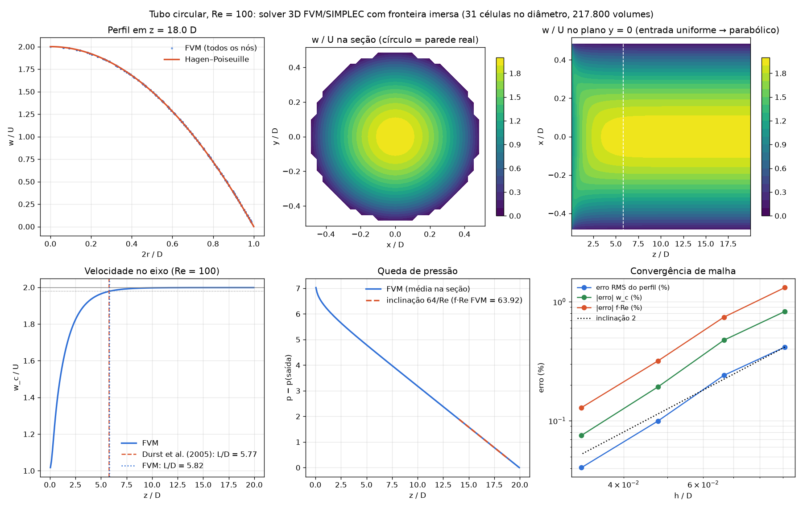

# fvm-cfd — Volumes Finitos para escoamentos viscosos incompressíveis

[](https://github.com/SEU-USUARIO/fvm-cfd/actions/workflows/testes.yml)
[](https://codespaces.new/SEU-USUARIO/fvm-cfd)

> Troque `SEU-USUARIO/fvm-cfd` pelo seu usuário/repositório nos links acima e abaixo.

Solvers de volumes finitos (SIMPLEC, malha desencontrada, 2ª ordem) para Navier–Stokes
incompressível em regime permanente, validados contra a literatura:

| Solver | Caso de validação | Referência |
|--------|-------------------|------------|
| 2D — Python (`python/cavity.py`) e JavaScript (`web/`) | Cavidade com tampa deslizante, Re = 100, 400, 1000 | Ghia, Ghia & Shin (1982) |
| 3D — Python (`python/fvm3d.py`) com fronteira imersa | Tubo circular, Re = 100: entrada e escoamento plenamente desenvolvido | Hagen–Poiseuille; Durst et al. (2005) |

<p align="center">
  
</p>

## Estrutura

```
fvm-cfd/
├── python/
│   ├── cavity.py        solver 2D (cavidade) + validação contra Ghia et al.
│   ├── ghia.py          dados de referência de Ghia et al. (1982)
│   ├── fvm3d.py         solver 3D geral (SIMPLEC, fronteira imersa, BiCGSTAB + CG/AMG)
│   └── pipe.py          validação 3D: tubo circular
├── web/                 versão JavaScript (roda no navegador / GitHub Pages)
│   ├── index.html  fvm.js  ghia.js
│   └── serve.ps1        servidor local em PowerShell (alternativa: python -m http.server)
├── tests/               testes rápidos (pytest, ~30 s)
├── docs/                figuras e métricas de referência das validações
├── .github/workflows/   testes a cada push, validação completa sob demanda, Pages
├── .devcontainer/       ambiente pronto para GitHub Codespaces
├── requirements.txt     numpy, scipy, matplotlib, pyamg
└── requirements-dev.txt + pytest
```

Os scripts gravam figuras (`.png`), campos (`.npz`) e métricas (`.json`) em `results/`
(ignorada pelo git; mude com `--out`).

## Como rodar na nuvem

**1. GitHub Actions — validação completa sem instalar nada.**
Aba **Actions → validacao → Run workflow**, escolha o caso (cavidade, tubo ou todos) e as
malhas. Ao terminar, baixe os resultados em **Artifacts** na página da execução.
Tempo aproximado nos runners gratuitos: cavidade 128×128 com 3 Reynolds ≈ 30 min; tubo com
11–31 células ≈ 10 min. Os testes rápidos (`testes.yml`) rodam sozinhos a cada push.

**2. GitHub Codespaces — terminal e VS Code no navegador.**
Botão **Code → Codespaces → Create codespace** (ou o selo acima). As dependências são
instaladas automaticamente; depois:

```bash
python python/cavity.py --Re 100 --N 64
python python/pipe.py --n 11 15 21
pytest
```

**3. GitHub Pages — a versão JavaScript, interativa.**
Ative uma vez em **Settings → Pages → Source: GitHub Actions**. A cada push que altere
`web/`, a página é publicada em `https://SEU-USUARIO.github.io/fvm-cfd/`.

## Como rodar localmente

```bash
pip install -r requirements-dev.txt
pytest                                     # testes rápidos
python python/cavity.py                    # cavidade: Re = 100, 400, 1000 em 128x128
python python/cavity.py --Re 1000 --N 64   # um caso, outra malha
python python/pipe.py --n 11 15 21 31      # tubo: estudo de malha
python python/pipe.py --n 31 --reanalyze   # refaz análise/figura a partir dos .npz
```

Versão web: `python -m http.server -d web 8000` e abra `http://localhost:8000/`
(ou `?Re=1000&N=128&auto` para disparar direto). No Windows sem Python:
`powershell -ExecutionPolicy Bypass -File web/serve.ps1` (porta 8765).

## Formulação

Equações em regime permanente, propriedades constantes:

    ∇·u = 0
    ρ ∇·(u u) = −∇p + μ ∇²u

Integrando no volume de controle V com faces f (teorema de Gauss):

    Σ_f F_f φ_f − Σ_f μ (∂φ/∂n)_f A_f = −∫_V ∂p/∂x_i dV ,   F_f = ρ (u·n)_f A_f

* **Malha desencontrada** (Harlow & Welch, 1965): p no centro, componentes da velocidade
  nas faces → sem oscilações tabuleiro-de-xadrez na pressão.
* **Difusão**: diferenças centrais, 2ª ordem. Nas paredes, gradiente com distância Δ/2.
* **Convecção**: upwind implícito + **correção diferida** para CDS
  (Khosla & Rubin, 1974): `b ← b − γ Σ_f F_f (φ_f^CDS − φ_f^UDS)`. Com γ = 1 a solução
  convergida é de 2ª ordem e a matriz continua diagonalmente dominante.
* **Coeficientes** (upwind): `a_E = D_e + max(−F_e, 0)`, `a_W = D_w + max(F_w, 0)`, …,
  `a_P = Σ a_nb + (F_e − F_w + F_n − F_s)`.
* **Acoplamento p–v: SIMPLEC** (Van Doormaal & Raithby, 1984):
  1. momento com p* (sub-relaxação α_u = 0,8): `(a_P/α) u* = Σ a_nb u*_nb + b + (1−α)(a_P/α) u⁰`
  2. `d_e = A_e / (a_P/α − Σ a_nb)` (no SIMPLE seria `A_e / (a_P/α)`)
  3. correção de pressão: `a_P p'_P = Σ a_nb p'_nb + b`, com `a_E = ρ d_e A_e` e
     `b` = desbalanço de massa da célula
  4. corrige `u = u* + d_e (p'_P − p'_E)`, `p = p* + α_p p'` (α_p = 1)
* **Convergência**: resíduos L1 normalizados de momento e massa < 10⁻⁶.

**Sistemas lineares.** Python 2D: solver esparso direto (SuperLU). JavaScript: TDMA
linha-a-linha (ADI) no momento; Gradiente Conjugado com multigrid de correção aditiva
(Hutchinson & Raithby, 1986) na pressão. Python 3D: BiCGSTAB no momento; CG com multigrid
algébrico (`pyamg`) na pressão.

### Fronteira imersa (3D)

Geometrias não cartesianas entram por uma função *level set* φ(x, y, z), negativa no fluido:

* as células com centro no fluido são marcadas como fluidas e a continuidade é imposta nelas
  (faces fluido–sólido fechadas);
* no momento, um vizinho sólido é substituído pela parede **real**, à distância θh obtida
  interpolando φ (tipo Shortley–Weller): o termo difusivo vira `μA/(θh)` com velocidade nula
  na parede. Isso mantém a 2ª ordem junto à parede curva, apesar da malha cartesiana.

Contornos nas seis faces do domínio: `('dirichlet', (u, v, w))` para paredes e entradas,
`('outlet',)` para saída (gradiente nulo + correção global de vazão; só em z+).

## Validação 1 — cavidade com tampa deslizante (2D)

Ghia, U., Ghia, K. N., Shin, C. T. *High-Re solutions for incompressible flow using the
Navier–Stokes equations and a multigrid method.* J. Comput. Phys. 48 (1982) 387–411.

Malha 128×128 volumes (Ghia: 129×129 nós):

| Re   | ψ_min FVM | ψ_min Ghia | Δψ     | centro FVM (x, y) | centro Ghia (x, y) | erro máx. u / v  |
|------|-----------|------------|--------|-------------------|--------------------|------------------|
| 100  | −0,10337  | −0,10342   | 0,05 % | (0,6153; 0,7378)  | (0,6172; 0,7344)   | 0,0046 / 0,0087  |
| 400  | −0,11343  | −0,11391   | 0,42 % | (0,5551; 0,6058)  | (0,5547; 0,6055)   | 0,0018 / 0,0048* |
| 1000 | −0,11727  | −0,11793   | 0,56 % | (0,5309; 0,5657)  | (0,5313; 0,5625)   | 0,0031 / 0,0120  |

Erros de u e v nos 17 pontos tabelados por Ghia. As versões Python e JavaScript dão os mesmos
valores até a 4ª casa (métricas em `docs/resultados_cavidade_N128.json`).

\* O valor de Ghia para Re = 400, v(x = 0,9063) = −0,23827, é apontado na literatura como erro
tipográfico (quebra a suavidade do perfil). O FVM dá −0,3875 nesse ponto; incluindo-o, o erro
máximo de v seria 0,149.

As diferenças de ψ_min (< 0,6 %) são da ordem da incerteza do próprio Ghia: soluções
espectrais (Botella & Peyret, 1998) dão ψ_min = −0,11894 em Re = 1000.

<p align="center">
  
</p>

Figuras de Re = 100 e 400 em [`docs/figures/`](docs/figures/).

## Validação 2 — tubo circular (3D)

Tubo de diâmetro D, Re = ρUD/μ = 100, perfil uniforme na entrada, L = 20 D, Δz = D/10.
Referências: Hagen–Poiseuille (`w = 2U(1 − (2r/D)²)`, `f·Re = 64`) e comprimento de entrada
de Durst, Ray, Ünsal & Bayoumi, *J. Fluids Eng.* 127 (2005) 1154:
`L/D = [0,619^1,6 + (0,0567 Re)^1,6]^(1/1,6)` (= 5,77 em Re = 100).

Perfil medido em z = 18 D; dp/dz ajustado em 14–19 D:

| células no D | volumes | iter. | erro w_c | erro RMS perfil | f·Re  | erro f·Re | L/D entrada |
|-------------:|--------:|------:|---------:|----------------:|------:|----------:|------------:|
| 11 |  33 800 | 153 | −0,83 % | 0,42 % | 63,16 | −1,32 % | 6,15 |
| 15 |  57 800 | 166 | −0,48 % | 0,24 % | 63,52 | −0,74 % | 5,97 |
| 21 | 105 800 | 190 | −0,19 % | 0,10 % | 63,80 | −0,32 % | 5,88 |
| 31 | 217 800 | 221 | −0,08 % | 0,04 % | 63,92 | −0,13 % | 5,82 |
| ref. | | | 0 | | **64** | | **5,77** |

* Ordem de convergência observada: **2,3** (perfil), **2,3** (f·Re), **2,4** (w_c).
* Extrapolação de Richardson (21 e 31 células, p = 2): f·Re → 64,02 e L/D → 5,77.
* Vazão conservada exatamente (Q/Q₀ = 1,0000) em todas as malhas.
* O estudo de malha refina só a seção transversal; Δz = D/10 fixo também influencia L/D.

## Limitações

* Regime permanente, propriedades constantes, malha uniforme.
* No 3D, saída apenas na face z+; validado só no tubo circular.
* A versão JavaScript resolve apenas a cavidade 2D.
