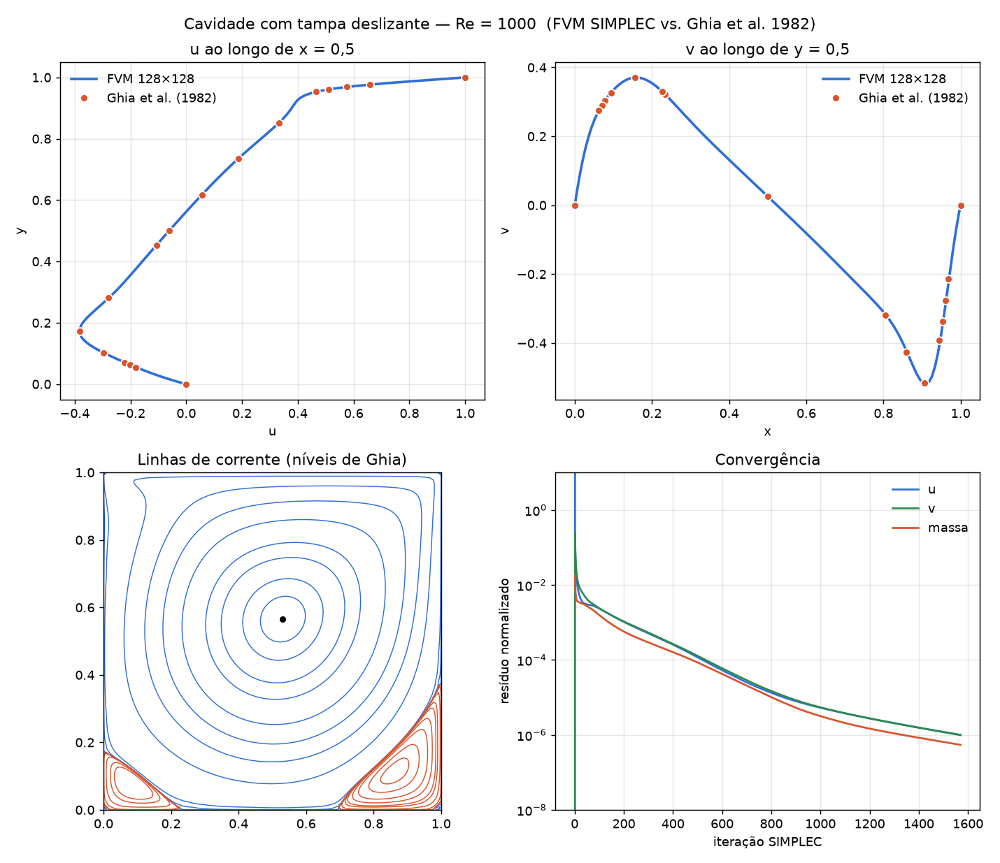
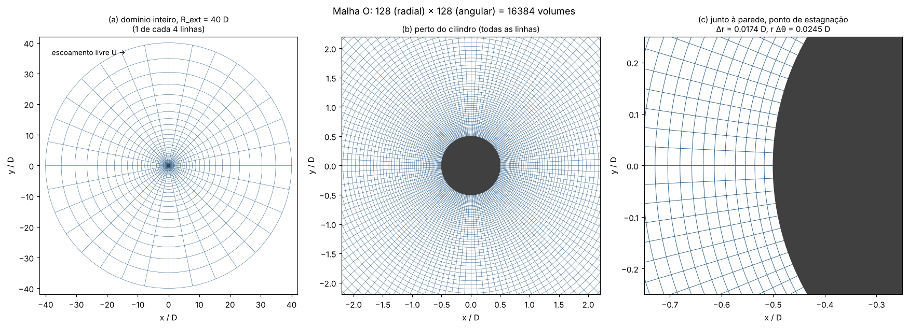
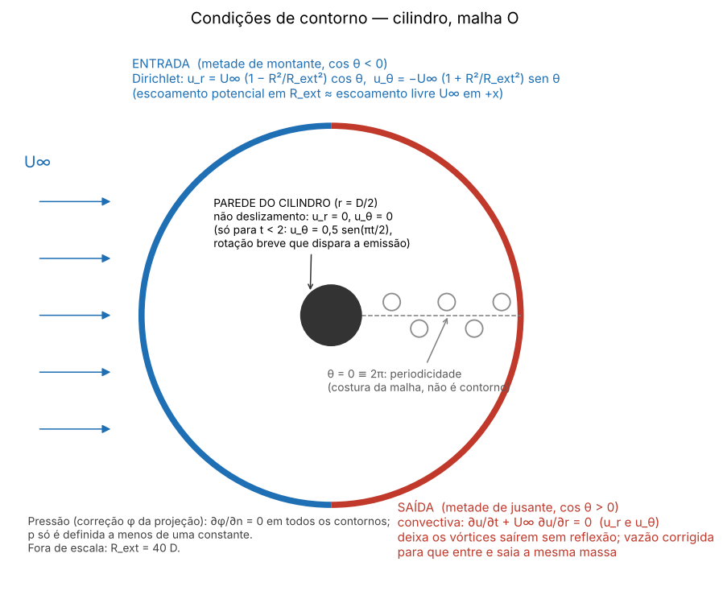
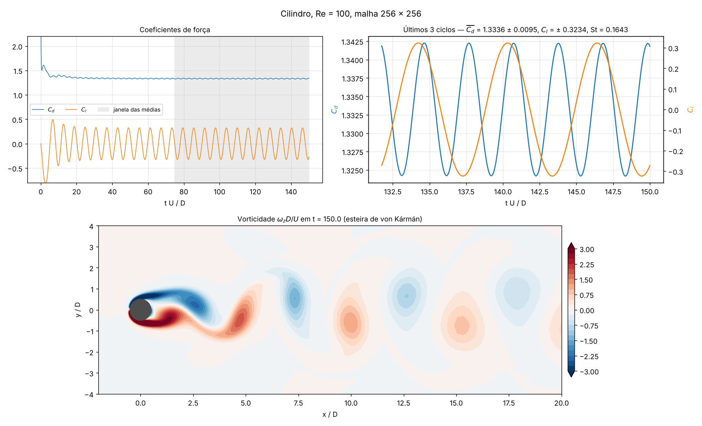
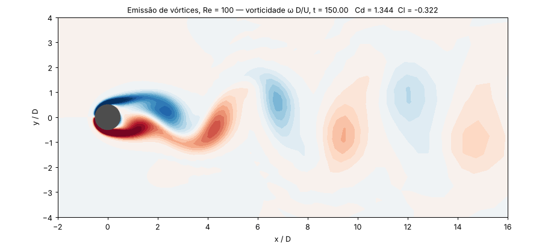
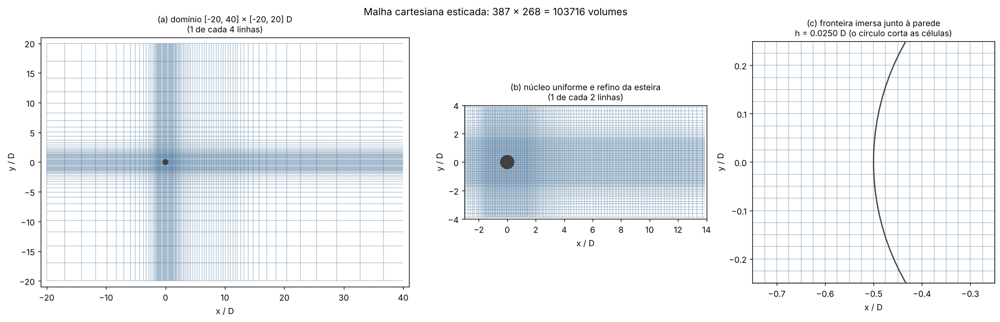
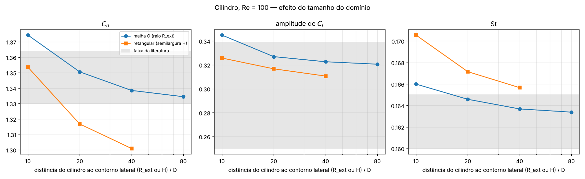
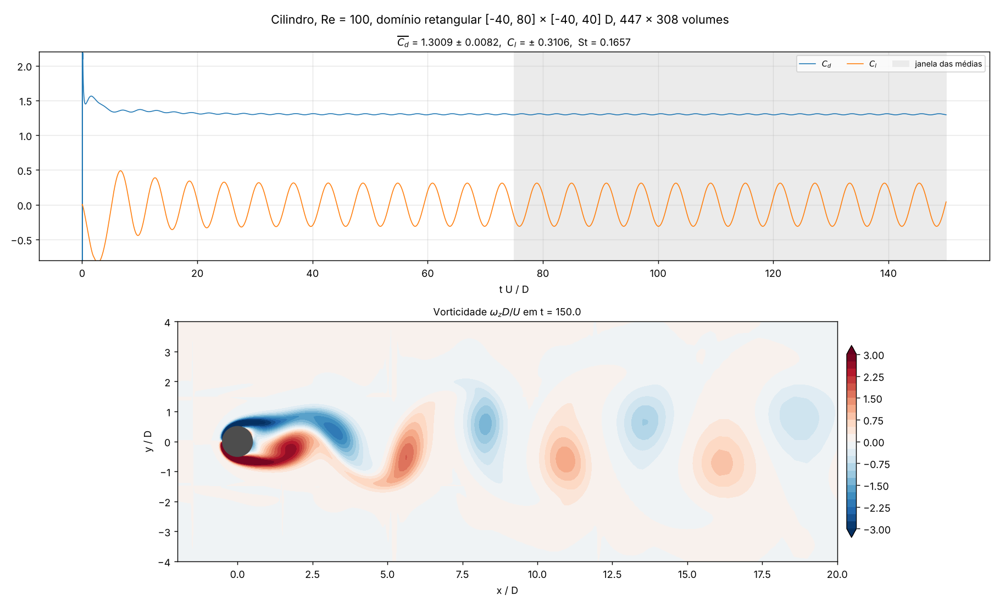
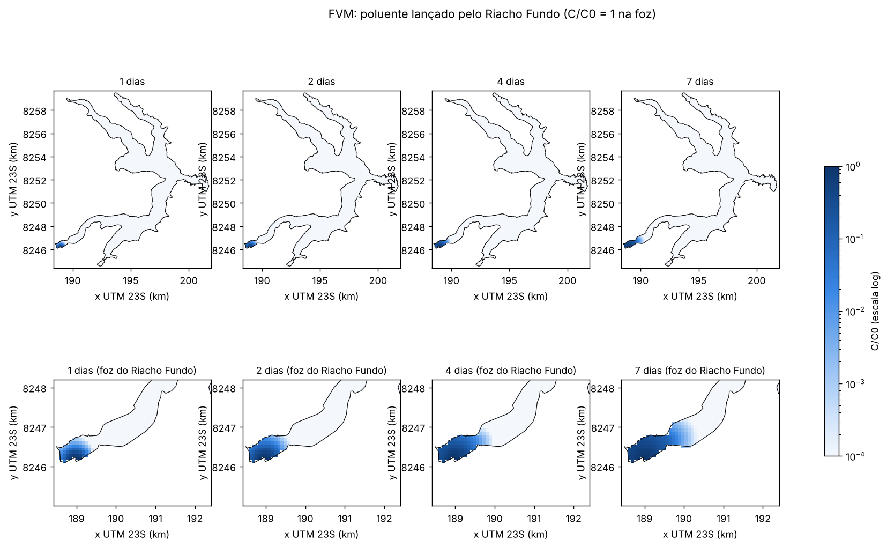

# fvm-cfd — Volumes Finitos para escoamentos viscosos incompressíveis

[](https://github.com/lucianonoleto79/fvm-cfd/actions/workflows/testes.yml)
[](https://codespaces.new/lucianonoleto79/fvm-cfd)

Solvers de volumes finitos (malha desencontrada, 2ª ordem) para Navier–Stokes
incompressível — SIMPLEC em regime permanente e passo fracionário no transiente —,
validados contra a literatura:

| Solver | Caso de validação | Referência |
|--------|-------------------|------------|
| 2D — Python (`python/cavity.py`) e JavaScript (`web/`) | Cavidade com tampa deslizante, Re = 100, 400, 1000 | Ghia, Ghia & Shin (1982) |
| 3D — Python (`python/fvm3d.py`) com fronteira imersa | Tubo circular, Re = 100: entrada e escoamento plenamente desenvolvido | Hagen–Poiseuille; Durst et al. (2005) |
| 2D transiente — Python (`python/polar.py`), malha O | Cilindro circular, Re = 100: esteira de von Kármán (Cd, Cl, Strouhal) | Braza et al. (1986); Liu et al. (1998); Park et al. (1998); Williamson (1988) |

<p align="center">
  
</p>

## Estrutura

```
fvm-cfd/
├── python/
│   ├── cavity.py        solver 2D (cavidade) + validação contra Ghia et al.
│   ├── ghia.py          dados de referência de Ghia et al. (1982)
│   ├── fvm3d.py         solver 3D geral (SIMPLEC, fronteira imersa, BiCGSTAB + CG/AMG)
│   ├── monitor.py       resíduos no terminal + curva de convergência durante a simulação
│   ├── control.py       pausar / salvar parciais / interromper, checkpoints e --resume
│   ├── polar.py         malha O + solver transiente em coordenadas polares
│   ├── cylinder.py      caso do cilindro (Re = 100): malha, forças, Strouhal
│   ├── cartesian.py     malha cartesiana esticada + fronteira imersa (domínio retangular)
│   ├── cylinder_rect.py cilindro em domínio retangular (tamanhos P, M, G)
│   ├── compare_domains.py  efeito do tamanho do domínio: malha O x retangular
│   ├── pipe.py          validação 3D: tubo circular
│   └── paranoa.py       Lago Paranoá: poluente (escalar) — o caso `paranoa` do Cordel em VF
├── web/                 versão JavaScript (roda no navegador / GitHub Pages)
│   ├── index.html  fvm.js  ghia.js
│   └── serve.ps1        servidor local em PowerShell (alternativa: python -m http.server)
├── tests/               testes rápidos (pytest, ~20 s)
├── docs/                figuras e métricas de referência das validações
├── .github/workflows/   testes a cada push, validação completa sob demanda, Pages
├── .devcontainer/       ambiente pronto para GitHub Codespaces
├── requirements.txt     numpy, scipy, matplotlib, pyamg
└── requirements-dev.txt + pytest
```

### Organização dos resultados

Cada caso simulado tem sua pasta em `results/` (mude com `--out`), sempre com os mesmos nomes.
**Domínio e malha são gerados antes de a simulação começar**, e a curva de convergência é
atualizada enquanto ela roda:

```
results/<caso>/
├── 01_dominio.png        domínio e condições de contorno     (antes de simular)
├── 02_malha.png          malha                                (antes de simular)
├── 03_convergencia.png   resíduos (permanente) ou Cd, Cl × t (transiente), durante a simulação
├── 04_resultados.png     resultados e comparação com a referência
├── 05_animacao_*.gif     animação (cilindro, --animate)
├── resultados.json       métricas
├── simulacao.log         saída do terminal (rodadas em segundo plano)
├── campos.npz            campos finais           (não versionado)
└── parcial.npz           checkpoint p/ --resume  (não versionado)
results/estudo_<nome>/    estudos com vários casos (malha, domínio): resumo .json e figuras
```

### Casos simulados

Tabela mantida automaticamente: cada script, ao terminar (ou interromper) um caso em
`results/`, regenera esta lista a partir de todas as pastas de caso
(`python python/casefiles.py` faz o mesmo à mão). Os resumos dos estudos estão em
`results/estudo_*`.

<!-- casos:inicio (tabela gerada por python/casefiles.py; não edite à mão) -->
_18 casos em `results/`, atualizado em 2026-11-25 18:03._

| caso | tipo | malha | resultados principais | situação | tempo | data | figuras |
|---|---|---|---|---|---:|---|---|
| [`cavidade_Re1000_N128`](results/cavidade_Re1000_N128/) | Cavidade, Re = 1000 | 128 × 128 | ψ_min = −0,11727 (Ghia −0,11793, erro 0,56 %); 1570 iterações | convergiu | 4 min | — | [domínio](results/cavidade_Re1000_N128/01_dominio.png) · [malha](results/cavidade_Re1000_N128/02_malha.png) · [convergência](results/cavidade_Re1000_N128/03_convergencia.png) · [resultados](results/cavidade_Re1000_N128/04_resultados.png) |
| [`cavidade_Re100_N128`](results/cavidade_Re100_N128/) | Cavidade, Re = 100 | 128 × 128 | ψ_min = −0,10337 (Ghia −0,10342, erro 0,05 %); 2048 iterações | convergiu | 6 min | — | [domínio](results/cavidade_Re100_N128/01_dominio.png) · [malha](results/cavidade_Re100_N128/02_malha.png) · [convergência](results/cavidade_Re100_N128/03_convergencia.png) · [resultados](results/cavidade_Re100_N128/04_resultados.png) |
| [`cavidade_Re400_N128`](results/cavidade_Re400_N128/) | Cavidade, Re = 400 | 128 × 128 | ψ_min = −0,11343 (Ghia −0,11391, erro 0,42 %); 1583 iterações | convergiu | 4 min | — | [domínio](results/cavidade_Re400_N128/01_dominio.png) · [malha](results/cavidade_Re400_N128/02_malha.png) · [convergência](results/cavidade_Re400_N128/03_convergencia.png) · [resultados](results/cavidade_Re400_N128/04_resultados.png) |
| [`cilindro_O_Re100_NT128_R10`](results/cilindro_O_Re100_NT128_R10/) | Cilindro, malha O, Re = 100, R_ext = 10 D | 88 × 128 (11.264 volumes) | Cd = 1,3744, Cl = ±0,3450, St = 0,1660 (12 ciclos) | concluído | 3 min | — | [domínio](results/cilindro_O_Re100_NT128_R10/01_dominio.png) · [malha](results/cilindro_O_Re100_NT128_R10/02_malha.png) · [convergência](results/cilindro_O_Re100_NT128_R10/03_convergencia.png) · [resultados](results/cilindro_O_Re100_NT128_R10/04_resultados.png) |
| [`cilindro_O_Re100_NT128_R20`](results/cilindro_O_Re100_NT128_R20/) | Cilindro, malha O, Re = 100, R_ext = 20 D | 108 × 128 (13.824 volumes) | Cd = 1,3506, Cl = ±0,3269, St = 0,1646 (11 ciclos) | concluído | 4 min | — | [domínio](results/cilindro_O_Re100_NT128_R20/01_dominio.png) · [malha](results/cilindro_O_Re100_NT128_R20/02_malha.png) · [convergência](results/cilindro_O_Re100_NT128_R20/03_convergencia.png) · [resultados](results/cilindro_O_Re100_NT128_R20/04_resultados.png) |
| [`cilindro_O_Re100_NT128_R40`](results/cilindro_O_Re100_NT128_R40/) | Cilindro, malha O, Re = 100, R_ext = 40 D | 128 × 128 (16.384 volumes) | Cd = 1,3385, Cl = ±0,3226, St = 0,1637 (11 ciclos) | concluído | 6 min | — | [domínio](results/cilindro_O_Re100_NT128_R40/01_dominio.png) · [malha](results/cilindro_O_Re100_NT128_R40/02_malha.png) · [convergência](results/cilindro_O_Re100_NT128_R40/03_convergencia.png) · [resultados](results/cilindro_O_Re100_NT128_R40/04_resultados.png) |
| [`cilindro_O_Re100_NT128_R80`](results/cilindro_O_Re100_NT128_R80/) | Cilindro, malha O, Re = 100, R_ext = 80 D | 148 × 128 (18.944 volumes) | Cd = 1,3345, Cl = ±0,3206, St = 0,1634 (11 ciclos) | concluído | 5 min | — | [domínio](results/cilindro_O_Re100_NT128_R80/01_dominio.png) · [malha](results/cilindro_O_Re100_NT128_R80/02_malha.png) · [convergência](results/cilindro_O_Re100_NT128_R80/03_convergencia.png) · [resultados](results/cilindro_O_Re100_NT128_R80/04_resultados.png) |
| [`cilindro_O_Re100_NT192_R40`](results/cilindro_O_Re100_NT192_R40/) | Cilindro, malha O, Re = 100, R_ext = 40 D | 192 × 192 (36.864 volumes) | Cd = 1,3353, Cl = ±0,3234, St = 0,1641 (11 ciclos) | concluído | 24 min | — | [domínio](results/cilindro_O_Re100_NT192_R40/01_dominio.png) · [malha](results/cilindro_O_Re100_NT192_R40/02_malha.png) · [convergência](results/cilindro_O_Re100_NT192_R40/03_convergencia.png) · [resultados](results/cilindro_O_Re100_NT192_R40/04_resultados.png) |
| [`cilindro_O_Re100_NT256_R40`](results/cilindro_O_Re100_NT256_R40/) | Cilindro, malha O, Re = 100, R_ext = 40 D | 256 × 256 (65.536 volumes) | Cd = 1,3336, Cl = ±0,3234, St = 0,1643 (11 ciclos) | concluído | 63 min | — | [domínio](results/cilindro_O_Re100_NT256_R40/01_dominio.png) · [malha](results/cilindro_O_Re100_NT256_R40/02_malha.png) · [convergência](results/cilindro_O_Re100_NT256_R40/03_convergencia.png) · [resultados](results/cilindro_O_Re100_NT256_R40/04_resultados.png) |
| [`cilindro_ret_Re100_G_h0.025`](results/cilindro_ret_Re100_G_h0.025/) | Cilindro, retangular G, Re = 100, [−40, 80] × [±40] D | 447 × 308, h = D/40 (137.676 volumes) | Cd = 1,3009, Cl = ±0,3106, St = 0,1657 (12 ciclos) | concluído | 76 min | — | [domínio](results/cilindro_ret_Re100_G_h0.025/01_dominio.png) · [malha](results/cilindro_ret_Re100_G_h0.025/02_malha.png) · [convergência](results/cilindro_ret_Re100_G_h0.025/03_convergencia.png) · [resultados](results/cilindro_ret_Re100_G_h0.025/04_resultados.png) |
| [`cilindro_ret_Re100_M_h0.025`](results/cilindro_ret_Re100_M_h0.025/) | Cilindro, retangular M, Re = 100, [−20, 40] × [±20] D | 387 × 268, h = D/40 (103.716 volumes) | Cd = 1,3168, Cl = ±0,3167, St = 0,1671 (12 ciclos) | concluído | 55 min | — | [domínio](results/cilindro_ret_Re100_M_h0.025/01_dominio.png) · [malha](results/cilindro_ret_Re100_M_h0.025/02_malha.png) · [convergência](results/cilindro_ret_Re100_M_h0.025/03_convergencia.png) · [resultados](results/cilindro_ret_Re100_M_h0.025/04_resultados.png) |
| [`cilindro_ret_Re100_M_h0.03333`](results/cilindro_ret_Re100_M_h0.03333/) | Cilindro, retangular M, Re = 100, [−20, 40] × [±20] D | 341 × 226, h = D/30 (77.066 volumes) | Cd = 1,2863, Cl = ±0,3020, St = 0,1679 (12 ciclos) | concluído | 29 min | — | [domínio](results/cilindro_ret_Re100_M_h0.03333/01_dominio.png) · [malha](results/cilindro_ret_Re100_M_h0.03333/02_malha.png) · [convergência](results/cilindro_ret_Re100_M_h0.03333/03_convergencia.png) · [resultados](results/cilindro_ret_Re100_M_h0.03333/04_resultados.png) |
| [`cilindro_ret_Re100_P_h0.025`](results/cilindro_ret_Re100_P_h0.025/) | Cilindro, retangular P, Re = 100, [−10, 20] × [±10] D | 347 × 236, h = D/40 (81.892 volumes) | Cd = 1,3536, Cl = ±0,3257, St = 0,1706 (12 ciclos) | concluído | 41 min | — | [domínio](results/cilindro_ret_Re100_P_h0.025/01_dominio.png) · [malha](results/cilindro_ret_Re100_P_h0.025/02_malha.png) · [convergência](results/cilindro_ret_Re100_P_h0.025/03_convergencia.png) · [resultados](results/cilindro_ret_Re100_P_h0.025/04_resultados.png) |
| [`paranoa_365d_h80`](results/paranoa_365d_h80/) | Lago Paranoá: poluente (escalar), 365 dias (ilustrativo) | 170 × 191, h = 80 m (5.947 no lago) | C/C0 média = 0,1758; sonda do braço do Riacho Fundo 1,0000; Q na barragem 8,50 m³/s; massa fecha a -2e-16 | concluído | 3 min | 2026-11-25 18:03 | [domínio](results/paranoa_365d_h80/01_dominio.png) · [malha](results/paranoa_365d_h80/02_malha.png) · [convergência](results/paranoa_365d_h80/03_convergencia.png) · [resultados](results/paranoa_365d_h80/04_resultados.png) |
| [`paranoa_7d_h80`](results/paranoa_7d_h80/) | Lago Paranoá: poluente (escalar), 7 dias (ilustrativo) | 170 × 191, h = 80 m (5.947 no lago) | C/C0 média = 0,0056; sonda do braço do Riacho Fundo 0,0020; Q na barragem 8,50 m³/s; massa fecha a -4e-16 | concluído | 3 s | 2026-11-25 13:10 | [domínio](results/paranoa_7d_h80/01_dominio.png) · [malha](results/paranoa_7d_h80/02_malha.png) · [convergência](results/paranoa_7d_h80/03_convergencia.png) · [resultados](results/paranoa_7d_h80/04_resultados.png) |
| [`tubo_Re100_n11`](results/tubo_Re100_n11/) | Tubo 3D, Re = 100 | 11 células no D (33.800 volumes) | f·Re = 63,16 (erro −1,32 %); L/D = 6,15 (Durst 5,77) | convergiu | 11 s | — | [domínio](results/tubo_Re100_n11/01_dominio.png) · [malha](results/tubo_Re100_n11/02_malha.png) · [convergência](results/tubo_Re100_n11/03_convergencia.png) · [resultados](results/tubo_Re100_n11/04_resultados.png) |
| [`tubo_Re100_n15`](results/tubo_Re100_n15/) | Tubo 3D, Re = 100 | 15 células no D (57.800 volumes) | f·Re = 63,52 (erro −0,74 %); L/D = 5,97 (Durst 5,77) | convergiu | 25 s | — | [domínio](results/tubo_Re100_n15/01_dominio.png) · [malha](results/tubo_Re100_n15/02_malha.png) · [convergência](results/tubo_Re100_n15/03_convergencia.png) · [resultados](results/tubo_Re100_n15/04_resultados.png) |
| [`tubo_Re100_n21`](results/tubo_Re100_n21/) | Tubo 3D, Re = 100 | 21 células no D (105.800 volumes) | f·Re = 63,80 (erro −0,32 %); L/D = 5,88 (Durst 5,77) | convergiu | 1 min | — | [domínio](results/tubo_Re100_n21/01_dominio.png) · [malha](results/tubo_Re100_n21/02_malha.png) · [convergência](results/tubo_Re100_n21/03_convergencia.png) · [resultados](results/tubo_Re100_n21/04_resultados.png) |
<!-- casos:fim -->

As figuras, métricas e logs de `results/` são versionados no git; os campos (`.npz`, ~70 MB)
não — regenere-os rodando os scripts.

## Como rodar na nuvem

**1. GitHub Actions — validação completa sem instalar nada.**
Aba **Actions → validacao → Run workflow**, escolha o caso (cavidade, tubo ou todos) e as
malhas. Ao terminar, baixe os resultados em **Artifacts** na página da execução.
Tempo aproximado nos runners gratuitos: cavidade 128×128 com 3 Reynolds ≈ 30 min; tubo com
11–31 células ≈ 10 min. Os testes rápidos (`testes.yml`) rodam sozinhos a cada push.

**2. GitHub Codespaces — terminal e VS Code no navegador.**
Botão **Code → Codespaces → Create codespace** (ou o selo acima). As dependências são
instaladas automaticamente; depois:

```bash
python python/cavity.py --Re 100 --N 64
python python/pipe.py --n 11 15 21
pytest
```

**3. GitHub Pages — a versão JavaScript, interativa.**
Ative uma vez em **Settings → Pages → Source: GitHub Actions** e rode
**Actions → pages → Run workflow**; a página sai em `https://lucianonoleto79.github.io/fvm-cfd/`.
(Em conta gratuita o Pages só funciona com o repositório público.) A versão web também roda
no Codespaces com `python -m http.server -d web 8000` (porta encaminhada automaticamente).

## Como rodar localmente

```bash
pip install -r requirements-dev.txt
pytest                                     # testes rápidos
python python/cavity.py                    # cavidade: Re = 100, 400, 1000 em 128x128
python python/cavity.py --Re 1000 --N 64   # um caso, outra malha
python python/pipe.py --n 11 15 21 31      # tubo: estudo de malha
python python/pipe.py --n 31 --reanalyze   # refaz análise/figura a partir dos .npz
python python/cylinder.py --mesh-only      # cilindro: só gera a figura da malha
python python/cylinder.py --NT 128         # cilindro Re = 100, malha 128 x 128 (~6 min)
```

### Monitor de convergência

Durante a simulação os resíduos (L1 normalizados de u, v, [w] e de massa) são impressos no
terminal e a curva de convergência é regravada em `results/<caso>/03_convergencia.png` a cada poucos
segundos — dá para deixá-la aberta num visualizador de imagens enquanto o cálculo roda:

```
    iter          u          v      massa   max/tol    it/s    tempo   (tol = 1e-06)
  ------------------------------------------------------------------
     200  1.554e-06  1.822e-06  1.159e-06  1.82e+00   117.7     1.7s
     215  8.280e-07  9.710e-07  6.177e-07  9.71e-01   120.3     1.8s
  -> convergiu em 215 iterações, 1.8 s
```

| Opção | Efeito |
|---|---|
| `--report N` | imprime os resíduos a cada N iterações (0 desliga; padrão 100 na cavidade, 50 no tubo) |
| `--refresh S` | atualiza a curva a cada S segundos (padrão 5) |
| `--live` | abre uma janela do matplotlib que se atualiza (precisa de tela; sem tela, avisa e usa só o arquivo) |
| `--no-curve` | não grava a curva durante a simulação |

Em código: `s.run(monitor=ConvergenceMonitor(['u', 'v', 'massa'], tol=1e-6, plot_file='conv.png'))`
(`from monitor import ConvergenceMonitor`).

### Pausar, salvar resultados parciais e interromper

Com a simulação rodando, ela pode ser comandada de três formas (`python/control.py`):

| Ação | Teclado (terminal) | Arquivo na pasta de saída | Efeito |
|---|---|---|---|
| Pausar / continuar | `p` | criar / apagar `PAUSAR` | congela o cálculo; a pausa não entra no tempo nem em it/s |
| Salvar parciais | `s` | criar `SALVAR` | grava o checkpoint `parcial.npz`, a curva de convergência e a figura do campo atual (`parcial.png`), na pasta do caso |
| Interromper | `q` ou `Ctrl+C` | criar `PARAR` | termina a iteração atual, salva o checkpoint, gera figuras e métricas do resultado parcial (marcado como interrompido) e encerra |
| Abortar | `Ctrl+C` duas vezes | — | sai na hora (código 130), mantendo o último checkpoint completo |

As teclas funcionam sem Enter (Linux, macOS e Windows) quando o script roda num terminal
interativo. Os arquivos servem para simulações em segundo plano, por ssh, no Codespaces ou no
GitHub Actions, por exemplo `touch results/PAUSAR` e depois `rm results/PAUSAR`; no PowerShell,
`ni results\PARAR`. Eles valem para todas as simulações que gravam na mesma pasta.
`SALVAR` e `PARAR` são apagados ao serem atendidos, e os que sobram de uma execução
anterior são removidos quando o script começa.

Além disso, um checkpoint é gravado a cada `--checkpoint S` segundos (padrão 300). Para
continuar de onde parou, rode o mesmo comando com `--resume`: os casos já convergidos
são reaproveitados, o interrompido continua do checkpoint e o histórico de resíduos segue
contínuo. Retomar dá o mesmo resultado de uma rodada sem interrupção (verificado em
`tests/test_controle.py`).

```bash
python python/cavity.py                 # ... q (ou Ctrl+C) no meio do Re = 400
python python/cavity.py --resume        # Re = 100 reaproveitado, Re = 400 continua, depois Re = 1000
```

| Opção | Efeito |
|---|---|
| `--checkpoint S` | checkpoint a cada S segundos (0: só ao salvar/interromper) |
| `--resume` | retoma dos checkpoints e reaproveita casos concluídos |
| `--no-keys` | não lê o teclado |
| `--control-dir D` | pasta vigiada pelos arquivos de comando (padrão: a de `--out`) |

Versão web: `python -m http.server -d web 8000` e abra `http://localhost:8000/`
(ou `?Re=1000&N=128&auto` para disparar direto). No Windows sem Python:
`powershell -ExecutionPolicy Bypass -File web/serve.ps1` (porta 8765).

## Formulação

Equações em regime permanente, propriedades constantes:

    ∇·u = 0
    ρ ∇·(u u) = −∇p + μ ∇²u

Integrando no volume de controle V com faces f (teorema de Gauss):

    Σ_f F_f φ_f − Σ_f μ (∂φ/∂n)_f A_f = −∫_V ∂p/∂x_i dV ,   F_f = ρ (u·n)_f A_f

* **Malha desencontrada** (Harlow & Welch, 1965): p no centro, componentes da velocidade
  nas faces → sem oscilações tabuleiro-de-xadrez na pressão.
* **Difusão**: diferenças centrais, 2ª ordem. Nas paredes, gradiente com distância Δ/2.
* **Convecção**: upwind implícito + **correção diferida** para CDS
  (Khosla & Rubin, 1974): `b ← b − γ Σ_f F_f (φ_f^CDS − φ_f^UDS)`. Com γ = 1 a solução
  convergida é de 2ª ordem e a matriz continua diagonalmente dominante.
* **Coeficientes** (upwind): `a_E = D_e + max(−F_e, 0)`, `a_W = D_w + max(F_w, 0)`, …,
  `a_P = Σ a_nb + (F_e − F_w + F_n − F_s)`.
* **Acoplamento p–v: SIMPLEC** (Van Doormaal & Raithby, 1984):
  1. momento com p* (sub-relaxação α_u = 0,8): `(a_P/α) u* = Σ a_nb u*_nb + b + (1−α)(a_P/α) u⁰`
  2. `d_e = A_e / (a_P/α − Σ a_nb)` (no SIMPLE seria `A_e / (a_P/α)`)
  3. correção de pressão: `a_P p'_P = Σ a_nb p'_nb + b`, com `a_E = ρ d_e A_e` e
     `b` = desbalanço de massa da célula
  4. corrige `u = u* + d_e (p'_P − p'_E)`, `p = p* + α_p p'` (α_p = 1)
* **Convergência**: resíduos L1 normalizados de momento e massa < 10⁻⁶.

**Sistemas lineares.** Python 2D: solver esparso direto (SuperLU). JavaScript: TDMA
linha-a-linha (ADI) no momento; Gradiente Conjugado com multigrid de correção aditiva
(Hutchinson & Raithby, 1986) na pressão. Python 3D: BiCGSTAB no momento; CG com multigrid
algébrico (`pyamg`) na pressão.

### Fronteira imersa (3D)

Geometrias não cartesianas entram por uma função *level set* φ(x, y, z), negativa no fluido:

* as células com centro no fluido são marcadas como fluidas e a continuidade é imposta nelas
  (faces fluido–sólido fechadas);
* no momento, um vizinho sólido é substituído pela parede **real**, à distância θh obtida
  interpolando φ (tipo Shortley–Weller): o termo difusivo vira `μA/(θh)` com velocidade nula
  na parede. Isso mantém a 2ª ordem junto à parede curva, apesar da malha cartesiana.

Contornos nas seis faces do domínio: `('dirichlet', (u, v, w))` para paredes e entradas,
`('outlet',)` para saída (gradiente nulo + correção global de vazão; só em z+).

## Validação 1 — cavidade com tampa deslizante (2D)

Ghia, U., Ghia, K. N., Shin, C. T. *High-Re solutions for incompressible flow using the
Navier–Stokes equations and a multigrid method.* J. Comput. Phys. 48 (1982) 387–411.

Malha 128×128 volumes (Ghia: 129×129 nós):

| Re   | ψ_min FVM | ψ_min Ghia | Δψ     | centro FVM (x, y) | centro Ghia (x, y) | erro máx. u / v  |
|------|-----------|------------|--------|-------------------|--------------------|------------------|
| 100  | −0,10337  | −0,10342   | 0,05 % | (0,6153; 0,7378)  | (0,6172; 0,7344)   | 0,0046 / 0,0087  |
| 400  | −0,11343  | −0,11391   | 0,42 % | (0,5551; 0,6058)  | (0,5547; 0,6055)   | 0,0018 / 0,0048* |
| 1000 | −0,11727  | −0,11793   | 0,56 % | (0,5309; 0,5657)  | (0,5313; 0,5625)   | 0,0031 / 0,0120  |

Erros de u e v nos 17 pontos tabelados por Ghia. As versões Python e JavaScript dão os mesmos
valores até a 4ª casa (métricas em `docs/resultados_cavidade_N128.json`).

\* O valor de Ghia para Re = 400, v(x = 0,9063) = −0,23827, é apontado na literatura como erro
tipográfico (quebra a suavidade do perfil). O FVM dá −0,3875 nesse ponto; incluindo-o, o erro
máximo de v seria 0,149.

As diferenças de ψ_min (< 0,6 %) são da ordem da incerteza do próprio Ghia: soluções
espectrais (Botella & Peyret, 1998) dão ψ_min = −0,11894 em Re = 1000.

<p align="center">
  
</p>

Figuras de Re = 100 e 400 em [`docs/figures/`](docs/figures/).

## Validação 2 — tubo circular (3D)

Tubo de diâmetro D, Re = ρUD/μ = 100, perfil uniforme na entrada, L = 20 D, Δz = D/10.
Referências: Hagen–Poiseuille (`w = 2U(1 − (2r/D)²)`, `f·Re = 64`) e comprimento de entrada
de Durst, Ray, Ünsal & Bayoumi, *J. Fluids Eng.* 127 (2005) 1154:
`L/D = [0,619^1,6 + (0,0567 Re)^1,6]^(1/1,6)` (= 5,77 em Re = 100).

Perfil medido em z = 18 D; dp/dz ajustado em 14–19 D:

| células no D | volumes | iter. | erro w_c | erro RMS perfil | f·Re  | erro f·Re | L/D entrada |
|-------------:|--------:|------:|---------:|----------------:|------:|----------:|------------:|
| 11 |  33 800 | 153 | −0,83 % | 0,42 % | 63,16 | −1,32 % | 6,15 |
| 15 |  57 800 | 166 | −0,48 % | 0,24 % | 63,52 | −0,74 % | 5,97 |
| 21 | 105 800 | 190 | −0,19 % | 0,10 % | 63,80 | −0,32 % | 5,88 |
| 31 | 217 800 | 221 | −0,08 % | 0,04 % | 63,92 | −0,13 % | 5,82 |
| ref. | | | 0 | | **64** | | **5,77** |

* Ordem de convergência observada: **2,3** (perfil), **2,3** (f·Re), **2,4** (w_c).
* Extrapolação de Richardson (21 e 31 células, p = 2): f·Re → 64,02 e L/D → 5,77.
* Vazão conservada exatamente (Q/Q₀ = 1,0000) em todas as malhas.
* O estudo de malha refina só a seção transversal; Δz = D/10 fixo também influencia L/D.

## Validação 3 — cilindro circular, Re = 100 (2D transiente)

**Malha O** gerada por `PolarGrid`: θ uniforme com NT divisões, r em progressão
geométrica de R = D/2 até R_ext = 40 D, células quase quadradas (Δr / rΔθ = 0,7).

<p align="center">
  
</p>

**Condições de contorno** (`PolarNS.update_outer` e parede em `python/polar.py`):

<p align="center">
  
</p>

**Solver** (`PolarNS`): equações em coordenadas polares com todos os termos de curvatura,
malha desencontrada, passo fracionário com projeção incremental (divergência ~1e-14),
Crank–Nicolson na difusão, Adams–Bashforth 2 + QUICK na convecção. Contorno externo:
escoamento livre a montante, saída convectiva a jusante. dt fixo pelo CFL do escoamento
potencial inicial (CFL ≈ 0,24 durante o desprendimento). Para disparar o desprendimento mais
cedo, o cilindro gira brevemente no início (t < 2); as médias usam t = 75–150 (11 ciclos).
Verificado antes contra a solução exata de Taylor–Couette (erro de 2ª ordem em u_θ e p).

| malha (r × θ) | volumes | dt | Cd médio | amp. Cd | amp. Cl | St | tempo |
|---|---:|---:|---:|---:|---:|---:|---:|
| 128 × 128 | 16 384 | 0,0051 | 1,3385 | 0,0094 | 0,3226 | 0,1637 | 6 min |
| 192 × 192 | 36 864 | 0,0033 | 1,3353 | 0,0095 | 0,3234 | 0,1641 | 24 min |
| 256 × 256 | 65 536 | 0,0025 | 1,3336 | 0,0095 | 0,3234 | 0,1643 | 63 min |
| Braza, Chassaing & Ha Minh (1986) | | | 1,364 | 0,015 | 0,25 | 0,160 | |
| Liu, Zheng & Sung (1998) | | | 1,350 | 0,012 | 0,339 | 0,164 | |
| Park, Kwon & Choi (1998) | | | 1,33 | — | 0,332 | 0,165 | |
| Williamson (1988), experimental | | | | | | 0,164 | |

* Os valores de referência são os que costumam ser tabelados em artigos de CFD para
  Re = 100; **confira nas fontes originais** antes de citá-los.
* Amplitude de Cl convergida (0,02 % entre as duas malhas finas); St com ordem observada 1,9
  e valor extrapolado 0,1645; Cd médio converge devagar (ordem aparente 0,7; extrapolação
  ≈ 1,326, pouco confiável) — o cálculo de forças na parede (pressão extrapolada, tensão
  por parábola de 3 pontos) e o dt, que muda com a malha, provavelmente limitam a ordem.
* Não foi feito estudo do tamanho do domínio (R_ext = 40 D fixo), que também afeta Cd.

<p align="center">
  
</p>

Emissão de vórtices (malha 128 × 128, 3 períodos a partir de t = 150;
`python python/cylinder.py --NT 128 --resume --animate 3`):

<p align="center">
  
</p>

## Efeito do tamanho do domínio — malha O × domínio retangular

Mesmo caso (Re = 100, mesmo esquema temporal), duas abordagens:

* **Malha O** (`cylinder.py`): ajustada ao corpo, 128 × NR, contorno circular de raio R_ext;
  entrada com o escoamento potencial em R_ext, saída convectiva.
* **Domínio retangular** (`cylinder_rect.py`, `cartesian.py`): malha cartesiana esticada com
  núcleo uniforme h = D/40, refino da esteira até 12 D; cilindro por **fronteira imersa**
  (ghost-cell); entrada u = U uniforme, laterais com deslizamento livre, saída convectiva;
  forças por balanço de quantidade de movimento num volume de controle. A malha perto do
  cilindro é idêntica em todos os tamanhos de domínio.

<p align="center">
  
</p>

| caso | volumes | Cd médio | amp. Cl | St |
|---|---:|---:|---:|---:|
| O, R_ext = 10 D | 11 264 | 1,3744 | 0,3450 | 0,1660 |
| O, R_ext = 20 D | 13 824 | 1,3506 | 0,3269 | 0,1646 |
| O, R_ext = 40 D | 16 384 | 1,3385 | 0,3226 | 0,1637 |
| O, R_ext = 80 D | 18 944 | 1,3345 | 0,3206 | 0,1634 |
| ret. P: [−10, 20] × [±10] D (bloqueio 5 %) | 81 892 | 1,3536 | 0,3257 | 0,1706 |
| ret. M: [−20, 40] × [±20] D (2,5 %) | 103 716 | 1,3168 | 0,3167 | 0,1671 |
| ret. G: [−40, 80] × [±40] D (1,25 %) | 137 676 | 1,3009 | 0,3106 | 0,1657 |
| ret. M com h = D/30 (sensibilidade à malha) | 77 066 | 1,2863 | 0,3020 | 0,1679 |

<p align="center">
  
</p>

* Domínio pequeno superestima Cd, Cl e St nas duas abordagens (contorno a 10 D: Cd 3–4 %
  acima do maior domínio).
* A malha O é bem menos sensível: de 40 para 80 D, Cd muda 0,3 % e St 0,2 %. Provável
  razão: a condição de entrada já é o escoamento potencial em torno do cilindro, enquanto o
  retangular impõe velocidade uniforme e confina o escoamento entre paredes laterais.
* No retangular, Cd varia aproximadamente na proporção do bloqueio D/2H (P→M: −0,037;
  M→G: −0,016), comportamento típico de correção de bloqueio.
* No maior domínio as abordagens ainda diferem (Cd −2,5 %, Cl −3 %, St +1,4 % no
  retangular). Não é efeito de domínio: refinar o núcleo do retangular de D/30 para D/40
  sobe Cd em 2,4 % e Cl em 4,9 % e baixa St em 0,5 %, sempre na direção da malha O. A
  fronteira imersa (ordem ~1,4–1,8 no teste de Taylor–Couette) ainda não está convergida em
  h = D/40; seria preciso h = D/60–D/80 (cerca de 2,5–6 h por caso neste código).
* Custo: o retangular usa 5–7× mais volumes que a malha O, mas resolve a esteira com
  nitidez até ~12 D (figura abaixo); a malha O é mais precisa e barata para as forças.

<p align="center">
  
</p>

## Lago Paranoá — dispersão de um poluente (caso do Cordel, ilustrativo)

`python/paranoa.py` resolve o caso `paranoa` do
[Cordel](https://github.com/lucianonoleto79/cordel) (`casos/paranoa.py`) com volumes finitos:
o mesmo contorno do OpenStreetMap (`python/dados/paranoa_contorno.json`, © OpenStreetMap
contributors, ODbL), as mesmas vazões dos cinco afluentes (8,5 m³/s na barragem), H = 12 m,
ν = κ = 0,1 m²/s e C/C0 = 1 na foz do Riacho Fundo. O lago é rasterizado numa malha cartesiana
uniforme (células cujo centro está dentro do contorno, margem em escada); as entradas e a saída
são velocidades normais prescritas nas faces de contorno junto às fozes e à barragem. Mesma
família numérica dos outros solvers (malha desencontrada, AB2 + Crank–Nicolson, projeção
incremental com Poisson fatorado uma vez); o escalar é explícito, com limitador TVD de van Leer.

```bash
python python/paranoa.py --dias 7                 # 1 semana, h = 80 m, Δt = 1800 s (~3 s)
python python/paranoa.py --apenas-malha           # só domínio e malha
```

Em 7 dias (336 passos, 3 s): C/C0 média no lago 0,0056, 0,0020 na sonda do braço do Riacho
Fundo, vazão na barragem 8,50 m³/s e massa do poluente conservada a 4×10⁻¹⁶. **Parâmetros
ilustrativos, não calibrados** (sem vento, Coriolis, atrito, batimetria nem estratificação);
não foi feito estudo de malha. A comparação com o Cordel e com o modelo de água rasa
([paranoa_agua_rasa](https://github.com/lucianonoleto79/paranoa_agua_rasa)), com sugestões de
tópicos para um trabalho de disciplina, está em
[`results/estudo_comparacao_paranoa/`](results/estudo_comparacao_paranoa/) (cópia do relatório do
Cordel, `resultados/comparacao_paranoa/`).

<p align="center">
  
</p>

## Limitações

* SIMPLEC (cavidade, tubo): regime permanente, propriedades constantes, malha uniforme.
* Domínio retangular: fronteira imersa ainda não convergida em h = D/40 (Cd ~2–4 % abaixo
  da malha O); estudo de refinamento só com dois níveis (D/30, D/40).
* Cilindro: malha O específica para corpo circular; a malha engrossa longe do corpo, o que
  difunde os vórtices da esteira (x > 10 D) sem afetar as forças no cilindro.
* No 3D, saída apenas na face z+; validado só no tubo circular.
* A versão JavaScript resolve apenas a cavidade 2D.
